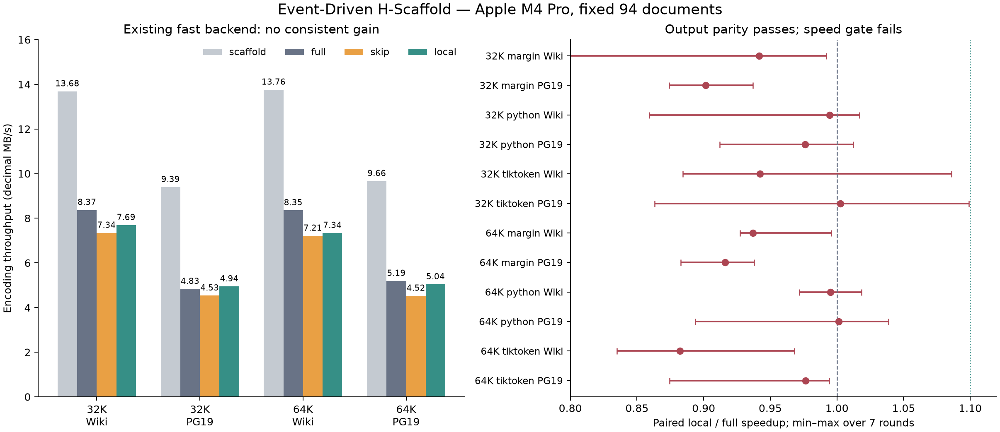

# Event-Driven H-Scaffold-BPE — 정확성 통과, 현 구현의 가속 효과 없음

2026-10-10 · 원래 목적 A(어휘 슬롯의 LM 효용)와 구분되는 C(인코딩 효율) 연구.

**결론: local propagation의 token IDs는 기존 H-Scaffold와 일치했지만,
실제 문서에서 일관된 속도 이득이 없었다. 현 Python 구현은 채택하지 않는다.**
이는 event-driven 아이디어 전체의 불가능성을 증명한 결과가 아니다.
검증한 구현·모델·문서·호스트에서 사전에 정한 가속 기준을 통과하지 못했다.

## 실제 수행 범위

- 원본 Scaffold/H tokenizers: 32,768 및 65,536. 정상 토큰 IDs와 bytes가 같음을 확인.
- Apple M4 Pro / Python 3.14.7. 한 CPU 프로세스, GPU·LM 학습·유료 호출 없음.
- WikiText 개발 문서 30개(513,041 raw bytes), PG19 기존 발췌문 64개(1,041,425 bytes).
- canonical research Python(`margin`), team Python, team tiktoken의 3개 경로.
- Scaffold / H-full / H-skip / H-local: 2 sizes × 2 domains × 3 backends = 12개 조건,
  조건당 7회. 입력 I/O·모델 생성 제외, encoding cache 없음, demolition cache warm.
- 방법 순서를 매 회전 바꿨고, 중앙값 MB/s와 같은 회차의 시간 비율을 보고했다.
  아래 범위는 반복 실행 min–max이며 신뢰구간이 아니다.
- 기준은 리팩터링 전 commit `0113d8e`의 실제 소스다. 신 구현이 추가한 호출 비용을
  기준 경로에 넣어 가속 효과를 과장하지 않았다. `baseline/`에 원본 코드를 고정했다.
- 벤치마크·차등 검사 소스: `8c873596e687c557ae7593e55587f7345e66bd4e`.

## 구현과 코드 리뷰

`src/hscaffold_bpe/remerge.py`의 linked adjacency + heap은 인접 후보를 유지하고,
병합 뒤 바뀐 두 이웃만 갱신한다. 유효하지 않은 오래된 항목은 현재 adjacency와
rule rank를 확인하고 버린다. 같은 최소 rank의 후보를 왼쪽부터 모두 처리한 뒤
새 후보를 넣으므로 기존의 **rank 단위 batch** 동작을 보존한다.

canonical 첫 pass는 pretoken별로 완전히 병합되어 있다. L2 분해로 생긴 내부·양옆
edge만 최초 frontier로 등록해도 충분하다. 생략된 edge는 처음에는 비후보이고,
그 edge가 바뀔 수 있는 유일한 원인인 이웃 병합 뒤에는 반드시 다시 등록된다.
이 불변식으로 각 reference batch와의 동등성을 설명할 수 있다.

**하지만 fast backend는 pretoken별 결과를 합친 후 전체 문서에서 두 번째 pass를 한다.**
따라서 L2가 없어도 pretoken 경계를 넘는 기존 후보가 남을 수 있다. 실제 모델로 만든
`"\na"` 회귀 테스트에서 blind skip이 틀린 결과를 만드는 반례를 확인했다.
fast `skip`은 기존 후보까지 검사하고, fast `local`은 최초 eligible edge를 전부 seed한다.
backend의 기존 경계 동작을 고치는 변경은 이번 가속 실험에 섞지 않았다.

새 heap은 초기 후보가 하나도 없으면 linked 배열을 만들지 않는다. 후보가 있으면
sequence 길이에 비례하는 arrays를 만들기 때문에 후보가 적다는 사실만으로 처리
비용이 후보 수에만 비례하지 않는다. 전체 seed 경로는 초기 O(n) 검사도 남는다.
순수 Python에서는 이 비용과 작은 후보 큐 관리 비용이 실제로 중요했다.

기존 공개 기본값은 유지했다: team=`full`, research=`event`.
`second_pass="local"`은 명시적으로 선택할 수 있다. research의 no-L2 skip은 이번에
처음 제안된 기법이 아니라 이미 있던 구현이다. allow-list 변경 시 새 rule table과
cache도 함께 갱신하고, local 설정의 저장·재로딩을 검사했다.

## 출력 동등성 결과

- 전체 테스트 **77 PASS**, 그중 새 exactness 테스트 7개.
- overlap·stale entry·비단조 rank를 포함한 임의 heap 사례 2,500개.
- 원본 32K/64K의 모든 L2 표면 주변, 긴 결합 입력, Unicode, 특수 토큰,
  무작위 문장을 포함한 **24,354 문서×모델×backend 조건**에서 두 변형 모두 일치.
  같은 문장을 여러 모델/backend에서 검사한 수이므로 독립 문서 24,354개라는 뜻은 아니다.
- 실제 benchmark 문서×모델×backend **564 조건**에서도 일치.
  매 회차 method별 ID hash를 다시 확인했다. warmup은 full과 IDs를 직접 비교했다.
- decode와 L0 출력 불변식, EOS, 기존 full 경로의 원본 대비 동등성도 통과했다.
- input/model SHA256는 서버 원본 및 기존 PG19 artifact와 일치했다.

검사 결과의 100% 일치는 전체 가능한 텍스트에 대한 실험적 전수 검사가 아니다.
위 batch/frontier 불변식과 회귀 검사가 함께 근거를 제공한다.

## 실제 fast 경로 속도

단위는 decimal MB/s. `local/full ×`는 회차별 `full 시간 / local 시간`의 중앙값으로,
두 MB/s 중앙값의 비율과 약간 다를 수 있다. 1보다 크면 local이 빠르다.

| Size / Domain | Scaffold | H-full | H-skip | H-local | Local/full × | 회차 범위 |
|---|---:|---:|---:|---:|---:|---|
| 32K Wiki | 13.684 | 8.369 | 7.345 | 7.691 | 0.942 | 0.884–1.086 |
| 32K PG19 | 9.394 | 4.833 | 4.534 | 4.944 | 1.003 | 0.863–1.099 |
| 64K Wiki | 13.757 | 8.353 | 7.213 | 7.339 | 0.882 | 0.835–0.968 |
| 64K PG19 | 9.661 | 5.191 | 4.525 | 5.037 | 0.976 | 0.874–0.994 |

정확한 값과 전 경로의 측정은 [TIMINGS.md](TIMINGS.md), [benchmark.json](benchmark.json).
32K PG19의 paired 1.003×는 실질적 이득으로 볼 수 없다. 64K 두 도메인의
사전 기준 **≥1.10×**와 32K 무회귀 조건은 실패했다. 같은 호스트의 full도 5 MB/s를
넘으므로 “local이 5 MB/s를 달성했다”는 말만으로는 개선 근거가 되지 않는다.
기존 보고서의 6.30/3.39 MB/s와는 호스트·코드·데이터 조건이 달라 절댓값을 비교하지 않는다.

canonical local도 full 대비 paired 0.902–0.942×로 느렸다. 기존 event skip은
0.998–1.031×로 작고 도메인별 차이가 있었다. team Python의 local은 0.976–1.001×였다.



## 왜 희소성만으로 속도가 나지 않았나

fresh canonical 측정에서는 실제 이벤트가 여전히 드물다.

| Size / Domain | Pretokens | L2-hit pretokens | 실제 2차 joins | 최종 출력이 달라진 pretokens |
|---|---:|---:|---:|---:|
| 32K Wiki | 98,830 | 125 | 14 | 7 |
| 32K PG19 | 251,247 | 802 | 98 | 89 |
| 64K Wiki | 98,830 | 69 | 9 | 9 |
| 64K PG19 | 251,247 | 555 | 73 | 73 |

그러나 native 경로의 skip 단위는 **문서**다. L2가 있는 문서는 32K Wiki 26/30,
64K Wiki 20/30, PG19는 두 size 모두 **64/64**다. pretoken의 희소성과 문서 단위의
skip 가능성을 혼동하면 잘못된 기대가 생긴다.

PG19 native에는 L2에 닿지 않는 eligible edge가 32K **88개**, 64K **8개** 있었다.
실제 native second-pass joins도 각각 **186/81회**로 canonical **98/73회**와 다르다.
L2 주변만 처리하는 fast 최적화는 이 동작을 보존할 수 없다.

고정 원본 fast 경로의 7회 isolated warm-stage profile에서 second merge의 시간
비중은 Wiki 약 **23–24%**, PG19 약 **30–36%**였다. 첫 native merge는 약 24–30%,
L2/L1 demolition 합계는 약 30–34%, ID mapping도 남았다. 이 비중은 개별 stage를
따로 측정한 합에 대한 비율이며, end-to-end의 인과적 시간 분해나 이론적 가속 한계가 아니다.
작은 Python 후보 관리와 배열 생성 비용을 치르는 local 구현이 이를 상쇄했다는 해석은
실제 시간 결과와 일관되지만, 특정 연산 하나의 원인까지 분리한 증거는 아니다.

## 연구 타당성과 신규성

이 실험은 원래 A의 “어떤 토큰이 vocabulary slot을 받을 가치가 있는가”를 해결하지
않는다. 어휘·분할·학습 목표를 바꾸지 않은 시스템 실험이다. 결과가 양성이어도
새 LM 학습 가설의 검증으로 말할 수 없으며, 이번에는 가속 결과도 음성이었다.

[Faster Superword Tokenization](https://arxiv.org/html/2604.05192v2)의 section 5에는
실제로 적용 가능한 pretoken에만 rule search를 하는 inference 최적화와 whole-pretoken
shortcut이 있다. [공식 tiktoken 소스](https://raw.githubusercontent.com/openai/tiktoken/main/src/lib.rs)는
긴 piece에 이미 heap·stale invalidation·neighbor update를 사용하고, 짧은 piece는
cache locality 때문에 vector 경로를 사용한다. heap이나 local update 자체는 새 기여가 아니다.

이번에 검증한 좁은 기여는 scaffold demolition의 frontier 조건, reference batch의
정확한 보존, 그리고 backend 경계 동작 때문에 실패하는 blind skip의 반례다.
독립 논문 수준의 신규성은 확인하지 못했다. 수업 발표에서는 **가속에 성공했다는 주장 대신
가설을 반증하고 비용/정확성 조건을 밝힌 결과**로 설명하는 것이 타당하다.

## LM·BPB 주장과 다음 결정

동일한 token IDs를 같은 유효 checkpoint·결정론적 평가에 넣으면 loss/BPB는 동일하다.
이것은 입력 동등성에서 따르는 명제다. 이번에 실제 기존 H 모델의 BPB를 재평가하지는 않았다.
역사적 2.513/2.530 수치는 기존 감사의 label-double-shift 문제와 불확실한 run lineage 때문에
품질 근거로 재사용하지 않는다. 따라서 “H의 LM 이득을 보존했다”는 성능 주장은 하지 않는다.

**결정: 현재 local 구현의 채택과 이에 기반한 확대 실험은 NO-GO.** 기본값을 바꾸거나
LM을 다시 학습하지 않는다. Python heap을 계속 튜닝해 결과를 찾는 것은 권하지 않는다.
진행한다면 다음 하나는 L2/pretoken 경계를 보존하는 compiled frontier의 독립 연구여야 하고,
기존 global fast 동작과 다른 tokenizer를 만든다면 새로운 품질 검증이 필요하다.
원래 A/B 연구와 이를 섞지 않는다. 이 후속 구현은 이번에 실행하지 않았다.

## 재현

repo root에서 `PYTHONPATH=src:research/src`를 설정한다. 의존성은 기존 환경의
numpy/regex/tiktoken, 그림만 matplotlib이다.

```sh
python research/scripts/event_driven_benchmark.py --inputs research/results/event_driven_v1/inputs --reps 7 --out /tmp/event-benchmark.json
python research/scripts/event_driven_audit.py --inputs research/results/event_driven_v1/inputs --out /tmp/event-audit.json
python research/scripts/event_driven_profile.py --inputs research/results/event_driven_v1/inputs --out /tmp/event-profile.json
python research/results/event_driven_v1/analyze.py
```

마지막 명령은 고정 artifact에서 표·결정·그림을 다시 만든다. 기존 benchmark/audit/profile
결과를 새 실행으로 덮어쓰지 않도록 `/tmp` 출력 예시를 사용했다.
