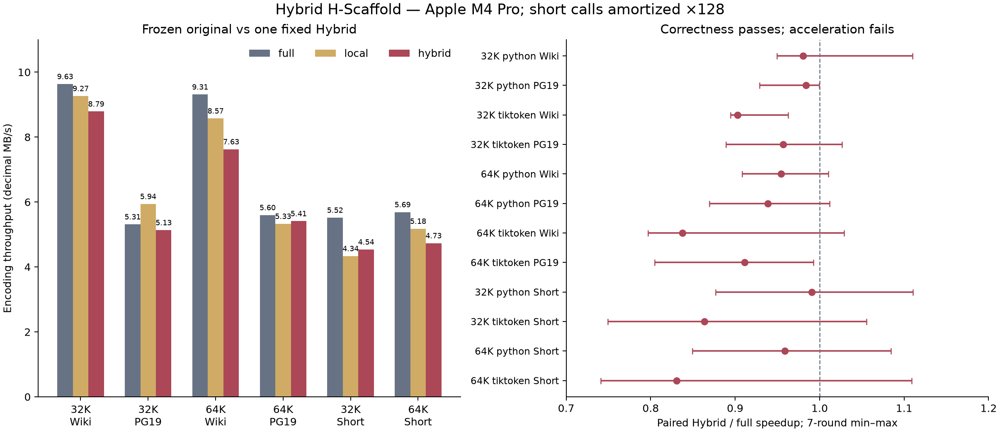

# 마지막 Hybrid 검증: 정확성 통과, 가속 실패 — local 최적화 중단

2026-10-11 · source `baa49a507cfc247e7c8c0fc2a3842e536e828080`.

**요청한 마지막 Hybrid 한 가지를 구현·비교했다. 출력은 일치했지만 원본 대비
실제 throughput 개선은 확인되지 않았다. `NO_GO_STOP_LOCAL_OPTIMIZATION`으로 종료한다.**
임계값을 다시 조정하거나 다른 local 방식·LM 학습·utility 설계를 이어서 실행하지 않았다.
이 결론은 이번 구현과 측정 조건에 대한 것이며 모든 event-driven 알고리즘의 불가능성을 뜻하지 않는다.

## 1. Frontier completeness: 무엇을 확인했나

모델의 merge list가 부여한 고유 rank와 유효한 demolition 구조를 전제로 한다.
queue에 유효하지 않은 오래된 entry가 더 있는 것은 허용하되, 다음을 유지한다.

\[
E(S)\subseteq\operatorname{valid}(Q)
\]

이 조건은 **초기 상태와 완료된 batch 사이**에 적용한다. 기존 full 구현은 같은 rank의
모든 비중첩 발생을 왼쪽부터 한 batch로 치환한다. batch 도중 새 edge를 곧바로 처리하면
더 낮은 rank가 노출되는 경우 원본과 달라질 수 있어, 새 후보는 batch 끝까지 미룬다.
따라서 batch 중의 조건은 pending changed nodes \(D\)를 포함한다.

\[
E(S)\subseteq\operatorname{valid}(Q)\cup
\operatorname{eligibleAdjacent}(D)
\]

원본 reference와 같은 batch를 처리한 뒤, 변경된 두 이웃을 등록하면 다시 첫 조건으로 돌아온다.
node는 원래 왼쪽 위치를 유지하므로 heap의 position tie-break도 reference 순서를 보존한다.

- production 함수의 실제 초기·batch 경계·**각 유효 join 이후**·전파 직전·종료 상태를
  trace해 검사했다. 후보를 의도적으로 누락한 경우 검사가 실패함도 확인했다.
- 임의 rule/sequence 200개와 canonical demolition frontier를 이 검사에 넣었다.
- 기존 독립 reference 대비 2,500개 arbitrary heap 사례와 비단조 rank batch 회귀 검사도 통과했다.
- fused collector가 만든 initial entries는 실제 문서 188개 size×domain 조건에서
  eligible adjacent edges를 직접 열거한 결과와 **완전히 같았다**.
- Hybrid의 random·Unicode·L2 stress·긴 결합 입력 검사:
  **16,236 문서×모델×backend 조건**에서 원본과 IDs가 일치했다.
  기존 세 backend 전체 audit는 24,354 조건이며 그중 두 team backend가 Hybrid 대상이다.
- 전체 테스트 **80 PASS**, 이후 각 join의 검사를 추가한 frontier 3개도 PASS.
  EOS·decode·L0 출력·기존 full API 동등성도 유지했다.

이는 귀납적 불변조건 설명과 실행 가능한 검사다. 모든 입력을 열거한 결과나
기계적으로 검증된 수학적 증명이라고 주장하지 않는다.

## 2. 한 번만 구현한 Hybrid

native 첫 merge 내부는 opaque해서 직접 후보 metadata를 얻을 수 없다. 대신 이미 수행하는
**L2 demolition의 token emission 중** 인접 rule을 조회하고 entries를 수집했다.
새 sequence 전체를 따로 순회하지 않았지만 Python inner loop·lookup 비용은 추가되며,
그 비용도 end-to-end 시간에 포함했다. “추가 순회 없음”은 “판단 비용 0”이라는 뜻이 아니다.

측정 전에 한 번 고정한 dispatch:

1. 첫 pass expanded sequence 길이 **128 미만**: 기존 full re-merge. 후보 collector 없음.
2. 나머지: demolition 중 모든 eligible edge를 수집. fast pretoken 경계의 기존 edge도 포함.
3. 후보 없음: second merge skip.
4. 초기 eligible rank 종류 **4 미만**: full fallback. 수집한 최소 pair를 첫 batch에 사용해
   같은 초기 sequence를 다시 scan하지 않는다. 이후에는 기존 full 탐색을 한다.
5. 나머지: precomputed 후보로 local heap. 초기 후보 탐색 scan을 다시 하지 않는다.

길이와 rank 다양성은 비용의 proxy다. 최적 dispatch라는 주장이나 threshold sweep은 없다.
기존 default는 `full`이며 실험은 `second_pass="hybrid"`를 명시해서 수행했다.
짧은 입력은 default fallback으로 보호했지만 분기·호출 비용까지 없어지는 것은 아니다.

실제 native 문서의 dispatch는 다음과 같다.

| Size / Domain | Empty skip | Seeded full | Local heap |
|---|---:|---:|---:|
| 32K Wiki (30 docs) | 23 | 7 | 0 |
| 32K PG19 (64 docs) | 15 | 46 | 3 |
| 64K Wiki (30 docs) | 24 | 6 | 0 |
| 64K PG19 (64 docs) | 31 | 31 | 2 |

초기 후보가 없어 skip하는 것과 L2가 없어서 skip하는 것은 다르다.
이 표는 timing 밖에서 같은 collector를 replay하여 얻었으며 timed 경로에 counters를 넣지 않았다.

## 3. 실제 throughput: 원본보다 빠르지 않았다

- 원본 full: commit `0113d8e`. 이전 local: `8c873596...`의 코드도 별도로 고정했다.
- 입력/model은 v1 그대로: 32K/64K, Wiki dev 30문서와 PG19 64발췌문.
- Apple M4 Pro / Python 3.14.7, 한 CPU 프로세스, 7회 rotated-order 비교.
- encoding cache 없음, demolition cache warm. 모델 생성·입력 I/O 제외.
- 모든 warmup은 IDs를 직접 비교하고, 매 timing 회차에서 동일 output hash를 확인했다.
- 별도 짧은 입력: 고정 Wiki pretoken pool 12,158개 중 seed 20261011로 1,024개 선택,
  UTF-8 길이 ≤32 bytes, **하나씩 encode 호출**했다. 원본 2–3ms 측정은 흔들림이 커서
  같은 samples/code를 ×128 반복했다. 131,072 calls/sweep이며 새로운 알고리즘 실험이 아니다.
  보정 후 native full 구간은 약 0.16–0.22초, Python full은 약 1.06–1.45초다.
  원래 짧은 측정도 `benchmark.json`에 보존하고, 보정 결과를 채택 판단에 사용했다.

단위 MB/s는 decimal 중앙값. paired ×는 회차별 `full 시간 / Hybrid 시간`의 중앙값으로,
두 throughput 중앙값의 비율과 약간 다를 수 있다. 범위는 min–max이며 신뢰구간이 아니다.

| Fast backend | Full MB/s | Hybrid MB/s | Paired × |
|---|---:|---:|---:|
| 32K Wiki | 9.635 | 8.789 | 0.903 |
| 32K PG19 | 5.314 | 5.135 | 0.957 |
| 64K Wiki | 9.313 | 7.627 | 0.838 |
| 64K PG19 | 5.598 | 5.412 | 0.911 |
| 32K short, ×128 | 5.518 | 4.539 | 0.863 |
| 64K short, ×128 | 5.690 | 4.733 | 0.831 |

전체 backend의 표는 [TIMINGS.md](TIMINGS.md), raw rounds는 [benchmark.json](benchmark.json) 및
[short_amortized.json](short_amortized.json)에 있다. Python Hybrid의 long paired 중앙값은
0.939–0.984×, 보정 short는 0.991×/0.959×였다. Hybrid의 원본 대비 재현되는 양성 효과는 없었다.
사전 practical go 조건(두 size/domain의 ≥5% 개선과 양성 반복, short 무회귀)도 실패했다.
숫자가 5 MB/s를 넘거나 v1보다 좋아 보이는 것은 원본 대비 개선의 증거가 아니다.
서로 다른 실행 시간의 절댓값을 비교하지 않고 이번 회차 내 원본과 비교했다.

대조군인 이전 local은 이번 32K PG19에서 paired 1.099×였지만 범위는 0.988–1.265×였다.
v1에서는 같은 조건의 중앙값이 1.003×였고, 전체 size/domain/short의 채택 조건을 만족하지 않았다.
특정 조건의 양성 관찰을 숨기지 않되, 이를 전반적인 가속이나 Hybrid의 성공으로 확대하지 않는다.



## 4. 세부 병목: queue pop은 큰 비용이 아니었다

actual 함수의 사본에 timer를 삽입해 원본 full scan / candidate generation / queue validation /
merge application / propagation / 배열 생성·출력을 분리했다. 모든 instrumented replay는
원본 output과 일치했다. 아래는 문서 전체 합의 7회 중앙값, 단위 ms.

| Kernel / Phase | 32K Wiki | 32K PG19 | 64K Wiki | 64K PG19 |
|---|---:|---:|---:|---:|
| Full: scan | 8.86 | 37.78 | 9.04 | 30.98 |
| Full: batch application | 1.93 | 17.67 | 2.02 | 11.63 |
| Local: initial candidate generation | 7.59 | 20.34 | 8.02 | 21.40 |
| Local: queue pop/validation | 0.01 | 0.08 | 0.01 | 0.05 |
| Local: neighbor candidate push | 0.01 | 0.04 | 0.01 | 0.03 |
| Local: linked-state setup | 0.51 | 3.16 | 0.43 | 2.28 |
| Local: output reconstruction | 0.68 | 4.21 | 0.55 | 2.98 |

Local join mutation 자체는 이 표의 scale에서 약 0.00–0.03ms로 작았다.
timer overhead가 작은 작업에 상대적으로 크므로 이는 미세한 절대 시간 주장에 쓰지 않는다.
초기 scan·출력·할당에 비해 queue pop을 더 최적화할 근거가 부족하다는 판단에는 충분하다.
이 kernel 표는 early sequence가 준비된 상태이며 pipeline 전체의 속도가 아니다.

별도로 **기존 L2 demolition**과 **fused demolition+후보 수집**을 같은 입력에서 비교했다.

| Domain | Plain demolition ms | Fused demolition+metadata ms |
|---|---:|---:|
| 32K Wiki | 6.64 | 18.93 |
| 32K PG19 | 19.55 | 53.98 |
| 64K Wiki | 6.70 | 20.42 |
| 64K PG19 | 19.48 | 55.97 |

별도 순회를 없애도 기존 C-level list extend를 Python emission/lookup으로 바꾸는 비용이 남았다.
fused 항목은 후보 탐색까지 포함하므로 plain demolition만과 동일 작업은 아니다.
full scan을 대체할 수 있는 절약까지 함께 따져야 하며, 최종 end-to-end 결과에서 이득이 없었다.
phase 중앙값을 더하거나 빼서 정확한 인과적 시간 분해라고 주장하지 않는다.
계측 source/hash·raw phases는 [kernel_profile.json](kernel_profile.json)와 instrumented 사본에 보존했다.

## 5. 종료 결정과 연구적 의미

정확성 검증은 성공했다. 가속 목표는 실패했다. 이 둘을 구분한다.
희소한 actual joins가 후보 발견·Python emission·전체 output 생성의 저비용을 보장하지 않는다.
이번 추가 실험에서도 그 비용을 상쇄하지 못했으므로 **더 이상 local 최적화를 진행하지 않는다.**

heap/neighbor update 자체의 신규성은 없다. [공식 tiktoken source](https://raw.githubusercontent.com/openai/tiktoken/main/src/lib.rs)
에도 관련 구현이 있다. 이번 연구의 좁은 산출물은 batch/frontier 조건과 fast boundary 반례,
단계별 비용, 그리고 한 가지 fixed Hybrid의 음성 결과다. 독립 논문 수준의 신규성이나
새 tokenization objective를 달성했다고 말하지 않는다.

원래 A의 vocabulary-slot utility와 B의 multilingual allocation은 별도다.
이번에는 LM 학습·BPB 재평가·새 utility 설계를 하지 않았다. 동일 IDs가 동일 유효 모델의
결정론적 loss를 보존한다는 것과 LM 성능이 개선됐다는 것은 다른 주장이다.
과거 보고서 BPB를 이번 품질 근거로 재사용하지 않았다.

## 재현과 보존

기준 source는 `baa49a507cfc247e7c8c0fc2a3842e536e828080`; v1 result commit은 `babe290449...`.
모델/본문은 `../event_driven_v1/inputs/`, 원본 full은 `../event_driven_v1/baseline/`,
이전 local은 `frozen_local/`에 고정했다. [SOURCE_VERIFY.json](SOURCE_VERIFY.json)에 lineage 검사를 기록했다.
모든 raw 결과를 보존하며 아래 재실행은 `/tmp`로 출력한다.

```sh
mkdir -p /tmp/hybrid
cp -R research/results/event_hybrid_v2/frozen_local /tmp/hybrid/
PYTHONPATH=src:research/src python research/scripts/event_hybrid_benchmark.py --inputs research/results/event_driven_v1/inputs --out /tmp/hybrid/benchmark.json
PYTHONPATH=src:research/src python research/scripts/event_driven_audit.py --inputs research/results/event_driven_v1/inputs --hybrid --out /tmp/hybrid-audit.json
PYTHONPATH=src:research/src python research/scripts/event_kernel_profile.py --inputs research/results/event_driven_v1/inputs --out /tmp/hybrid-profile/profile.json
PYTHONPATH=src:research/src:research/scripts python research/results/event_hybrid_v2/repeat_short.py --out /tmp/hybrid-short.json
python research/results/event_hybrid_v2/analyze.py
```

benchmark는 output parent의 `frozen_local/`을 사용한다. 위 예시는 고정 사본을 복사한다.
짧은 보정 스크립트는 원래 samples/hash/source를 확인하고 실행한다.
그림·결정 생성은 고정 artifact만 읽는다.
